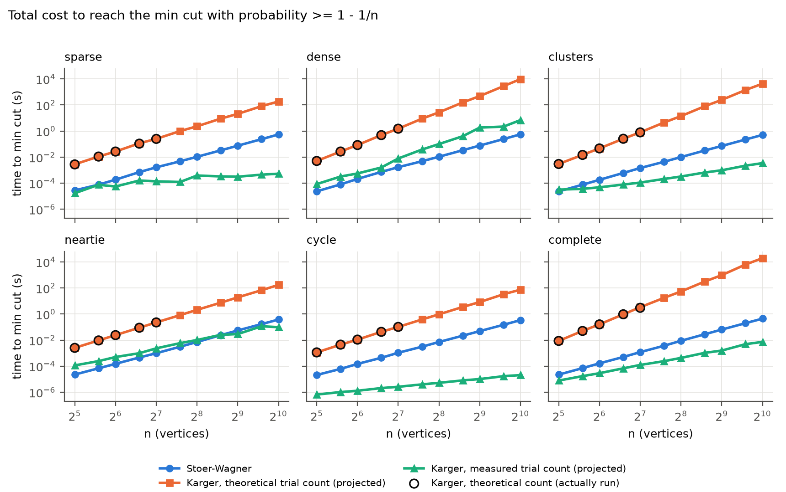
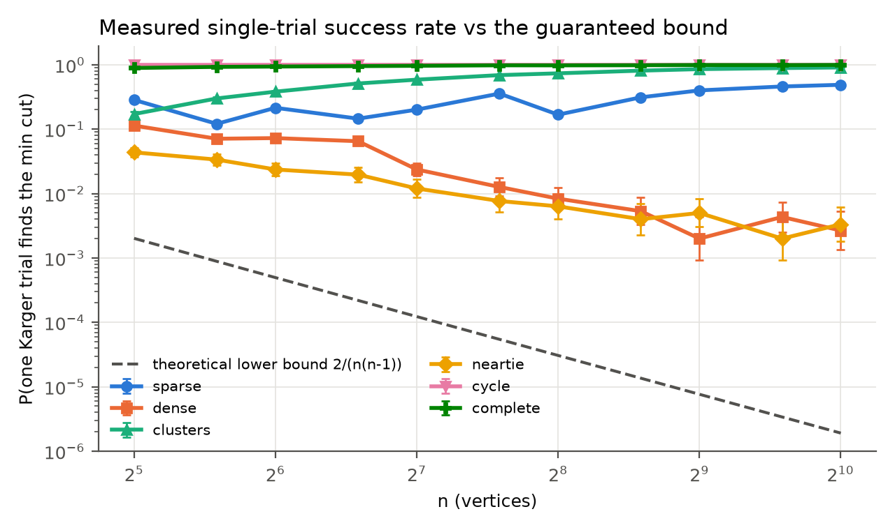
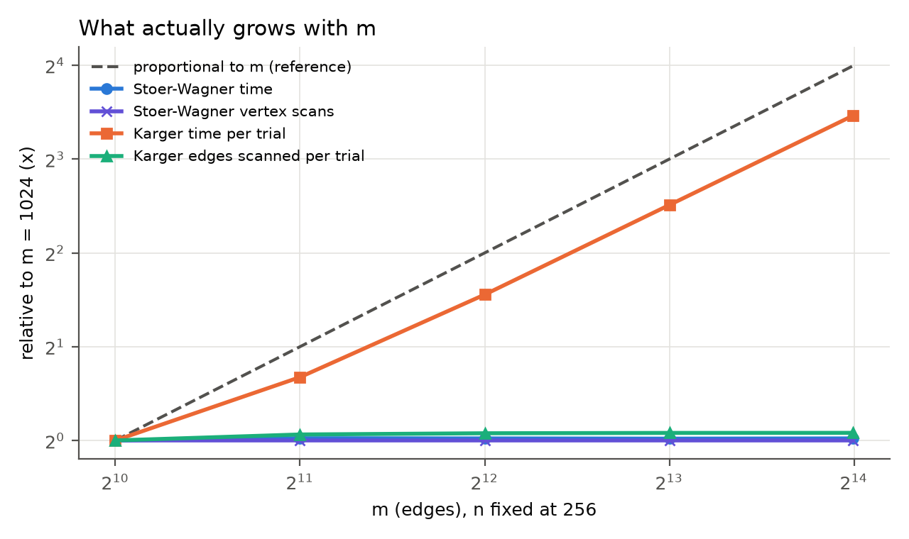
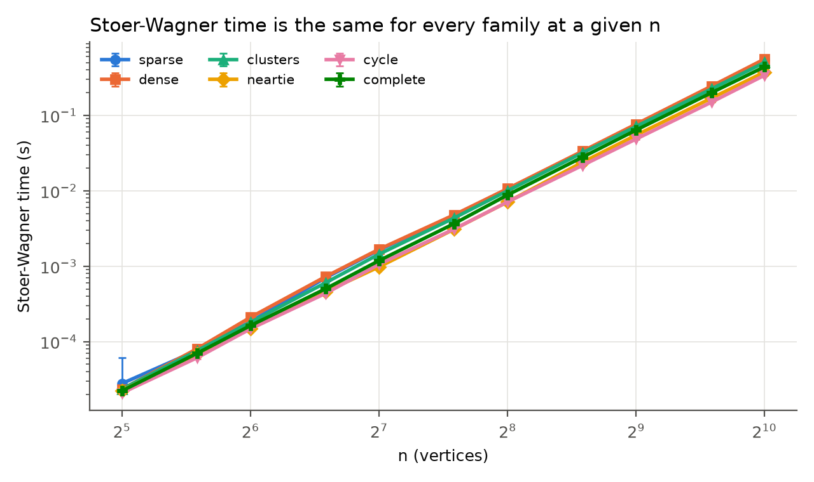
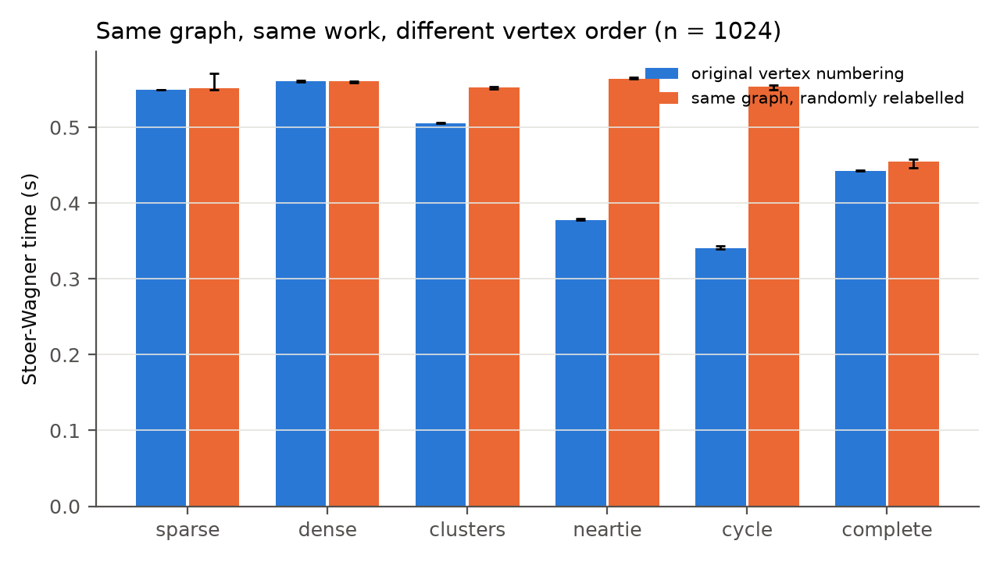

# Minimum Cut: Karger vs Stoer-Wagner

**Programming Assignment 2: Deterministic vs Randomized (Theme 2)**
Individual project. Primary author of both algorithms: Lazizbek Ismoilov
Repository: `pa2-min-cut-lazizbek`. Every number below is generated by `scripts/analyse.py` from the committed raw data in `results/` (tables in `results/tables.md`, figures in `figures/`).

---

## 1. The problem and the algorithms

### The problem

Take an undirected graph G = (V, E) with n vertices and m edges. Parallel edges are allowed, self-loops are not. A **cut** splits V into two non-empty sets S and V \ S. Its value is the number of edges with one endpoint on each side. The **global minimum cut** is a cut of smallest value. There's no source or sink, so any split counts. The min cut is the weakest point of a network: how few links have to fail before it splits in two.

There are 2^(n-1) - 1 possible cuts, so trying them all only works for small n. My brute-force oracle (`src/brute_force.hpp`) does exactly that for n <= 20 and is used only to check the two real algorithms.

### Karger's contraction algorithm (randomized)

**Idea.** Pick a uniformly random edge and *contract* it: merge its two endpoints into one super-vertex, keep any parallel edges, drop the self-loops this creates. Repeat until two super-vertices remain. The edges between them are a cut. One run (a *trial*) can be unlucky, so you run many trials and keep the smallest cut you find.

**Why it works.** Fix a minimum cut C of value k. Every vertex has degree at least k (otherwise that vertex alone would be a smaller cut), so the graph has at least nk/2 edges. The chance the first random edge is in C is at most k / (nk/2) = 2/n. Carrying that through every contraction gives the classic bound: one trial returns C with probability at least

  p_min = 2 / (n(n-1)).

To find C with probability at least 1 - 1/n you need about (n choose 2) ln n trials. At n = 1024 that's 3,630,539 trials.

**My implementation** (`src/karger.hpp`). One trial shuffles the edge list once, then walks through it with a union-find (path compression + union by rank, the same structure as my PA1 optimised version), merging endpoints and skipping any edge whose endpoints are already in the same blob. It stops at 2 blobs. Skipping self-loops in a random order gives every remaining real edge the same chance of being next, so this has the same outcome distribution as "contract a uniformly random remaining edge", but costs only O(m) for the shuffle plus O(m α(n)) for contraction. A disconnected graph never reaches 2 blobs and correctly returns 0.

**What makes it different.** It's short, it never looks at the graph's structure, and it's a Monte Carlo algorithm: it can be wrong, and it can't tell you when it is.

### Stoer-Wagner (deterministic)

**Idea.** Each *phase* grows a set A one vertex at a time, always adding the remaining vertex with the largest total edge weight into A (its *key*). The last vertex added, t, has everything else already in A, so its key is exactly the value of the cut "t's blob vs everything else". Record that cut, merge t into the second-last vertex s, and start the next phase. After n - 1 phases one vertex is left, and the smallest recorded cut is the global minimum.

**Why it works.** The cut recorded in a phase is a minimum s-t cut. For any global min cut C, either s and t are on opposite sides of C, and then this phase's cut is at least as good as C, or they're on the same side, and merging them loses nothing. So some phase always records a min cut.

**My implementation** (`src/stoer_wagner.hpp`) is the simple dense version: an n x n weight matrix (parallel edges summed), and a linear scan to find the max key. Each phase does O(n^2) work, so the whole thing is O(n^3) time and Θ(n^2) memory, **whatever m is**. `notes.md` has a phase-by-phase trace on a small graph, reproduced exactly by `scripts/trace_sw.cpp`.

**What makes it different.** It always returns the right answer, and the answer certifies itself: the returned partition is a real cut with the claimed value. The price is a fixed n^3 regardless of how easy the graph is.

---

## 2. Theoretical comparison and predictions

These predictions were committed in `predictions.md` (commit `d4ca1a0`) before any algorithm code existed, and haven't been edited since. They're reproduced here unchanged.

**Costs on paper.**

| | Karger | Stoer-Wagner |
|---|---|---|
| one trial / one run | O(m) (shuffle + union-find) | O(n^3), independent of m |
| trials for success prob >= 1 - 1/n | (n choose 2) ln n | 1 |
| total | O(n^2 m log n), ~n^4 log n when dense | O(n^3) |
| memory | O(m) | Θ(n^2) matrix |
| sensitive to | m, and how many near-minimum cuts compete | n only |
| can be wrong? | yes, with prob <= 1/n at that trial count | no |

**What I expected (verbatim from `predictions.md`):**

1. If Karger runs the theoretical trial count, Stoer-Wagner wins basically everywhere above tiny n. I don't expect a real crossover in that setup.
2. The theoretical bound is very pessimistic. On random graphs I expect one trial to succeed far more often than 0.08%, maybe several percent or more, because the min cut is often just the lowest-degree vertex, which is hard to "accidentally" destroy. If that's true, Karger with a *measured* trial count could actually beat Stoer-Wagner on sparse graphs.
3. Stoer-Wagner's runtime should look almost identical across graph families at the same n, since the array version does the same n^3 work regardless of structure.
4. Karger gets hurt most when the true min cut isn't a single vertex and there are lots of near-minimum cuts competing with it, e.g. a planted balanced cut only slightly smaller than the minimum degree.
5. Cycle graphs: Karger should succeed on 100% of trials.

(The 0.08% in prediction 2 is 2/(n(n-1)) at n = 50.)

---

## 3. Experimental methodology

### Input families

All generators are in `src/generators.hpp`, deterministic for a given (n, seed), and tested in `tests/test_generators.cpp` against what each one promises (size, edge count, connectivity, no duplicates, and the planted min cut where there is one).

| family | construction | m | why it's here |
|---|---|---|---|
| sparse | random simple graph, connected | 4n | Karger's cheapest case per trial |
| dense | random simple graph, edge prob 1/2, connected | n(n-1)/4 | Karger pays for every edge; Stoer-Wagner unchanged |
| clusters | two dense halves (p = 1/2), 3 random cross edges; every vertex degree >= 4 | ~n^2/8 | min cut (3) is a balanced cut, not a vertex |
| neartie | two degree-6 ring lattices, 5 cross edges | 3n + 5 | planted balanced cut of 5 with every vertex at degree 6 or 7: built to be Karger's hard case (prediction 4) |
| cycle | n-cycle | n | Karger can't fail (prediction 5); sanity check |
| complete | K_n | n(n-1)/2 | densest possible input |
| gnm | random connected graph with exactly m edges | chosen | vary m at fixed n |

Sizes: n in {32, 48, 64, 96, 128, 192, 256, 384, 512, 768, 1024}. That's three random instances per (family, n) for the random families, and one for cycle and complete, which are fixed by n.

### Three experiments

1. **Scaling with n**, every family. Stoer-Wagner timed directly. Karger timed per trial (a batch of trials divided by the batch size), and its single-trial success rate measured over 1,000 trials per instance (3,000 per point for random families, 1,000 for cycle and complete).
2. **Vary m at fixed n = 256**, m in {1024, 2048, 4096, 8192, 16320}. This tests whether each algorithm's cost tracks m the way the theory says.
3. **Vertex order.** Stoer-Wagner on the same n = 1024 graph, in its original vertex numbering vs three random relabellings. I added this *after* experiment 1 showed something prediction 3 said shouldn't happen (Section 5.3).

### How Karger's total cost is computed

Running Karger at 3.6 million trials per graph isn't feasible for every point, so total cost is **projected**: median per-trial time x trials needed. Two trial counts are compared, both aiming for success probability >= 1 - 1/n:

- **theoretical:** (n choose 2) ln n, from the worst-case bound;
- **measured:** ln n / -ln(1 - p̂), where p̂ is the measured single-trial success rate. This solves (1 - p̂)^k = 1/n.

To check the projection isn't hiding something (allocation, cache effects across trials), I also **ran Karger in full at the theoretical count for n <= 128**, 5 repetitions each. Table 2 compares the two. Measured / projected is between 0.90 and 1.01 across all 30 points, and 28 of the 30 are within 0.99-1.01. The one outlier is complete at n = 128, where the full run was 10% *faster* than projected.

### Benchmarking setup

- **Hardware/software:** Apple M3 MacBook Air, macOS (Darwin 27.2), Apple clang 21.0, `-std=c++23 -O2` (recorded in `results/machine.txt`). Mains power, other apps closed, machine not used during runs.
- **Timing:** `std::chrono::steady_clock` around the algorithm call only. Graph generation, correctness checks and file output are all outside the timed region.
- **Warm-up and repetitions:** one untimed run per algorithm per instance, then 11 timed repetitions (5 for full Karger runs). Karger per-trial batches are sized so one batch lasts a few milliseconds (5-2,000 trials).
- **Variance:** every point is the median over repetitions x instances, with the interquartile range shown as error bars and in the tables. Stoer-Wagner's IQR at n = 1024 is under 2% of the median for every family. The largest IQR anywhere, 31% of the median, is on a Karger per-trial point.
- **Success rates** are pooled counts with 95% Wilson intervals.
- **Operation counts** (to test explanations, not just propose them): Stoer-Wagner vertex scans and "pick changes" (how often the find-max loop replaces its current best), Karger edges scanned per trial. Stoer-Wagner's counts come from a separate untimed run, so counting can't affect its times.

### Fairness and correctness

- **Same instances:** each graph is generated once and the same object goes to both algorithms.
- **Answers checked before timing.** The harness aborts the whole run if:
  - Stoer-Wagner's partition isn't a valid two-sided cut with the claimed value;
  - it misses a family's planted min cut;
  - any Karger trial ever finds a *smaller* cut than Stoer-Wagner, which would prove Stoer-Wagner wrong.

  The final run checked 169,000 Karger trials this way with no failures.
- **Tests:** both algorithms match brute force on hand-checked graphs and 300 random graphs (n = 2-14), and agree with each other on 40 larger graphs (n = 20-40). Karger returns 2 on all 10,000 trials of a 12-cycle. Bugs found by two adversarial "attack" chats are covered by regression tests (`tests/test_attack.cpp`, Section 8).
- **Comparable effort:** both are straightforward textbook versions. Neither is tuned, and Section 6 lists the obvious optimisation for each.
- **Reproducing:** `make test`, `make bench`, then `.venv/bin/python scripts/analyse.py` (see README).

---

## 4. Results and analysis

### 4.1 At the theoretical trial count, Stoer-Wagner wins everywhere

*Figure 3. Time to reach the min cut with probability >= 1 - 1/n. Circles are real full Karger runs at the theoretical count. They sit on the projected orange line, which is the projection check from Table 2.*

The orange line (Karger at (n choose 2) ln n trials) is above the blue line (Stoer-Wagner) at every n in every family. The *smallest* gap anywhere is 54x, on the cycle at n = 32. At n = 1024, Stoer-Wagner takes 342-560 ms. Karger at the theoretical count would take between 1.2 minutes (cycle) and 5.4 hours (complete) (Table 1). **Prediction 1 holds.**

The reason is in the cost formulas. The trial count alone is Θ(n^2 log n), and each trial is Θ(m), so even on the cycle (m = n) Karger is Θ(n^3 log n): a log factor *worse* than Stoer-Wagner before constants. On complete graphs it's Θ(n^4 log n). That's why the gap widens fastest on dense, clusters and complete in Figure 3: their orange lines are steeper because m grows like n^2.

### 4.2 At the measured trial count, Karger wins on five of six families

The green line uses the trial count Karger actually needs, given its measured success rate. At n = 1024 it beats Stoer-Wagner on sparse, clusters, neartie, cycle and complete. On clusters it takes 3.44 ms vs 505 ms, and on sparse 0.53 ms vs 548 ms (Table 1). It loses only on dense.

| family | where Karger (measured) wins | Stoer-Wagner time / Karger time, range over n |
|---|---|---|
| sparse | every n | 1.0x - 1,033x |
| cycle | every n | 32x - 16,688x |
| complete | every n | 2.9x - 61x |
| clusters | n >= 48 | 0.74x - 147x |
| neartie | n >= 512 (crossover between 384 and 512) | 0.20x - 3.8x |
| dense | never | 0.04x - 0.46x |

Two things decide each row: **how many trials Karger needs** (from p̂, Section 4.3) and **what each trial costs** (from m, Section 4.4).

- **Dense loses on both counts.** p̂ = 0.003 at n = 1024, so about 2,600 trials, and every trial shuffles 261,888 edges (2.68 ms per trial).
- **Complete has an even bigger m** (523,776 edges, 5.35 ms per trial) but needs 1.4 trials, because p̂ = 0.994.
- **Neartie is as hard as dense per trial** (p̂ = 0.003) but has only m = 3n + 5 edges, so each trial is 47 µs. Fitting log-log slopes over all n: the per-trial time grows like n^1.00 and the trials needed like n^1.06, so Karger's total grows like about n^2.1, while Stoer-Wagner grows like n^2.8. Karger starts 5x behind at n = 32, and the steeper n^3 overtakes it between n = 384 and 512. That's the one real crossover inside our range.

**Prediction 2 holds, much more strongly than I expected.** I predicted "several percent or more". The real p̂ is between 22x and 523,776x the bound, and on three families it goes *up* with n (Section 5.1).

**An important caveat about the green line.** The measured count uses p̂ measured on the same instances, which you'd never know in practice. Karger is Monte Carlo: it can't tell you it has found the minimum. If you don't know p for your graphs, the only *guaranteed* trial count is the theoretical one, and there Stoer-Wagner wins everywhere. So the honest summary is: **Karger is far faster when you can afford to trust it, and Stoer-Wagner is the only one that gives a certificate.** That's exactly the theme's question of where each pays for its randomness or determinism. Karger pays in tail risk: on dense at n = 1024, a run of 100 trials would still miss the min cut about 77% of the time ((1 - 0.00267)^100).

### 4.3 Karger's success rate depends on structure, not just n

*Figure 1. Measured single-trial success rate (95% Wilson intervals) against the 2/(n(n-1)) bound.*

Table 4 has every value. The families split into two groups.

- **Rising toward 1 with n: cycle (exactly 1.000 at every n), complete (0.892 → 0.994), clusters (0.172 → 0.909).** For the cycle, every two-arc split is a min cut, so a trial can't fail. **Prediction 5 holds:** 1,000 out of 1,000 trials at every n. For complete and clusters the bound shrinks like 1/n^2, but the measured rate *grows*. Section 5.1 explains why.
- **Falling with n: dense (0.114 → 0.003) and neartie (0.044 → 0.003).** These are the two families where many cuts are close to the minimum.
  - **Neartie** was built for this: the planted cut is 5, and every one of the n vertices is a cut of 6 or 7.
  - **Dense** got there by accident. Its min cut is the lowest-degree vertex (455 at n = 1024), and degrees in G(n, 1/2) cluster tightly around n/2, so many vertices are only a little above the minimum.

  **Prediction 4 is half right.** Neartie is Karger's hardest per-trial case, but dense is just as hard, and I didn't predict that. My explanation for dense (lots of near-minimum vertex cuts) is consistent with what we see, but I haven't measured it directly. Section 6 says how I would.
- **Sparse** stays between 0.12 and 0.49 and is noisy between instances, because its min cut is often a degree-1 or degree-2 vertex (min cut 1 at n = 1024).

### 4.4 Stoer-Wagner ignores m; a Karger trial pays for all of m

*Figure 4. n = 256, m varied 16x. Everything is relative to m = 1024. The dashed line is "proportional to m".*

| m | Stoer-Wagner | SW vertex scans | Karger per trial | edges scanned per trial |
|---|---|---|---|---|
| 1,024 | 10.55 ms | 11,250,400 | 13.7 µs | 615 (60% of m) |
| 16,320 | 10.71 ms | 11,250,400 | 151.4 µs | 651 (4% of m) |

(Full data: Table 3.)

- **Stoer-Wagner.** Its vertex-scan count is *identical* at every m, and its time moves by 1.5%. This is the measured version of "the array version doesn't depend on m". Across all families, its time vs n has a log-log slope of 2.79-2.86 for n >= 256, close to the cubic it should be.
- **Karger per trial** grows 11x for a 16x increase in m, and its time vs m has a log-log slope of 0.99-1.05 in every family. But the number of edges a trial actually *looks at* before reaching 2 blobs barely moves (615 → 651).

So the contraction work is roughly fixed at about 2.5n edges. The thing that grows with m is the **upfront shuffle of all m edges**, which the trial mostly never uses. On complete graphs at n = 1024, a trial looks at 0.6% of the shuffled edges (Table 5). Section 5.2 covers this.

### 4.5 Stoer-Wagner's speed depends on vertex order

*Figure 2. Stoer-Wagner time by family. Same n, same number of vertex scans, but not the same time.*

**Prediction 3 was wrong as stated.** At n = 1024, Stoer-Wagner takes 342 ms on cycle and 560 ms on dense, a 1.64x gap. Both do exactly the same number of vertex scans, because that count depends only on n. The IQRs are under 2%, so this isn't noise. Section 5.3 finds the cause.

---

## 5. What surprised me

### 5.1 The success rate on planted cuts goes *up* with n, and a simple model mostly explains it

**Predicted.** Prediction 2 said the bound 2/(n(n-1)) would be pessimistic, by "several percent or more". I still pictured the success rate *falling* with n, just more slowly than the bound.

**Measured.** On clusters, p̂ rises from 0.172 at n = 32 to 0.909 at n = 1024, while the bound falls from 2.0 x 10^-3 to 1.9 x 10^-6. At n = 1024 the measured rate is 475,938x the bound (Table 1, Figure 1). Complete does the same (0.892 → 0.994). Neartie, with a similar planted structure, falls (0.044 → 0.003).

**Explanation, and how I checked it.** On these two families a trial succeeds exactly when it never contracts one of the k planted cross edges. If none is contracted the two halves can never join, so the trial must end with each half as one blob, which is the planted cut. In my implementation a trial walks a random permutation of the edges and stops after S of them. So the trial succeeds if none of the k cross edges lands in the first S positions, which is roughly

  p ≈ (1 - S/m)^k.

The key quantity is **S/m: what fraction of the edges a trial looks at before it stops**. I counted S directly (Table 5).

- **Clusters:** S grows like n while m grows like n^2, so S/m shrinks (0.384 → 0.029) and p → 1. The bound assumes the worst case, where every contraction is a fresh chance to hit the cut. Here almost all of the m edges are inside the halves and are never even reached.
- **Neartie:** m is only 3n + 5, and a trial has to scan most of it (S/m rises from 0.41 to 0.67), so p → 0.

Table 6 compares the model's prediction with the measurement at every n:

| family, n | S/m | predicted p | measured p (95% CI) |
|---|---|---|---|
| clusters, 32 | 0.384 | 0.233 | 0.172 (0.159-0.186) |
| clusters, 1024 | 0.029 | 0.916 | 0.909 (0.898-0.918) |
| neartie, 32 | 0.413 | 0.070 | 0.044 (0.037-0.052) |
| neartie, 1024 | 0.667 | 0.004 | 0.003 (0.002-0.006) |

The model gets the direction right for both families and the size right to within 2x everywhere. For clusters at n >= 384 it's inside the 95% interval. Overall it lands inside the interval in **7 of 22 rows**, and when it misses, it always *over*-predicts. So it's the right mechanism but not the whole story. My best guess at the gap: S is averaged over all trials, but a trial that has already contracted a cross edge has fewer blobs left to merge and may stop at a different point than a successful one. I haven't tested that (Section 6).

### 5.2 A Karger trial mostly shuffles edges it never uses

**Predicted.** Karger costs O(m) per trial. I took that to mean the contraction loop was the work.

**Measured.** At n = 256, going from m = 1,024 to 16,320 (16x), the per-trial time rises 11x. But the number of edges a trial actually processes before stopping only goes from 615 to 651 (Table 3). On complete graphs at n = 1024, a trial looks at 0.6% of the edges it shuffled (Table 5).

**Explanation, and how I checked it.** If contraction were the cost, time would follow edges scanned, which is flat. Instead it follows m, with a log-log slope of 0.99-1.05 in every family. The only per-trial step that touches all m edges is the `std::shuffle` of the index array (plus filling it). So on anything denser than a cycle, almost all of a trial's time goes into **randomising the order of edges it will never reach**. A trial needs only about 2.5n edges (n - 2 real merges plus the skipped self-loops), and that doesn't depend on m.

This also changes how I read Section 4.2. Karger loses on dense mostly because of this shuffle, not because the algorithm is inherently expensive there. Drawing random edges lazily (Section 6) would make a trial O(n log n)-ish instead of O(m).

### 5.3 Same graph, same work, 1.6x different time: Stoer-Wagner's vertex order

**Predicted.** Prediction 3: Stoer-Wagner's time should be "almost identical across graph families at the same n".

**Measured.** At n = 1024 it ranges from 342 ms (cycle) to 560 ms (dense), even though the number of vertex scans is identical. Repetitions are within 2% of each other (Figure 2), so the gap is real.

**Explanation, and how I checked it.** The only thing that differs between families at a fixed n is *which* vertex wins each find-max scan, and when. In the cycle and neartie generators, neighbours have consecutive numbers, so the keys grow in an orderly pattern and the running maximum rarely changes. In a random graph it changes constantly. I counted how often the find-max loop replaces its current best ("pick changes") and then ran **experiment 3**: the same graph, randomly relabelled. Relabelling changes only the vertex numbers. The structure, the min cut and the scan count are unchanged (the harness checks the min cut).

*Figure 5. Stoer-Wagner on the same graph in its original numbering vs randomly relabelled (n = 1024).*

| family | original | relabelled | pick changes: original → relabelled |
|---|---|---|---|
| cycle | 341 ms | 554 ms (1.62x) | 524,799 → 1,041,280 |
| neartie | 378 ms | 564 ms (1.49x) | 723,115 → 1,667,610 |
| clusters | 506 ms | 553 ms (1.09x) | 2,382,940 → 2,647,290 |
| sparse | 549 ms | 552 ms (1.00x) | 1,724,100 → 1,706,017 |
| dense | 561 ms | 561 ms (1.00x) | 2,655,720 → 2,657,033 |
| complete | 443 ms | 455 ms (1.03x) | 699,050 → 699,050 |

(Full data with IQRs: Table 7.)

Once the numbering is random, **every family except complete lands at 552-564 ms**, so prediction 3 holds once vertex order is controlled. The two families that were fast (cycle, neartie) lost their speed, and the ones that were already random (sparse, dense) didn't change. Complete is a useful control: every relabelling of K_n is the same graph, so the pick count can't change, and the time barely does.

**What this doesn't explain.** Pick changes and time correlate at 0.75 across the 12 rows, not 1. The clearest counterexample: neartie in its original numbering makes *more* pick changes than complete (723,115 vs 699,050) but is 65 ms *faster* (378 ms vs 443 ms). So it isn't the *number* of replacements alone. My hypothesis is that it's how *predictable* they are to the CPU's branch predictor: a replacement that happens in a regular pattern is nearly free, and a random one costs a misprediction. I can't measure branch mispredictions with my current setup, so this part stays a hypothesis.

---

## 6. What I'd do next

- **Lazy edge sampling for Karger.** Instead of shuffling all m edges, draw random edge indices on demand (or do a partial Fisher-Yates shuffle) and stop once 2 blobs remain. Section 5.2 predicts this would make a trial's cost depend on S (about 2.5n) rather than m, so Karger should beat Stoer-Wagner on dense graphs too. It's directly testable with the existing harness.
- **Karger-Stein.** Recursive contraction raises the success probability to Ω(1/log n) per run. It would be interesting to see whether it still matters when the measured p̂ is already far above the bound on most families.
- **Heap-based Stoer-Wagner**, O(nm + n^2 log n). This would show where the sparse-graph regime changes the deterministic side of the comparison, and it removes the Θ(n^2) memory that limits the array version.
- **Test the remaining hypotheses directly:**
  - **Section 5.3:** measure branch mispredictions with hardware performance counters (Instruments on macOS, `perf` on Linux).
  - **Section 4.3:** count the near-minimum cuts in dense graphs, e.g. vertices within 5% of the min degree, to confirm why dense is so hard for Karger.
  - **Section 5.1:** log S separately for successful and failed trials, to explain why the model always over-predicts.
- **A practical stopping rule for Karger.** The measured trial count assumes you know p. Real use would need something like "stop once the best cut has repeated r times" with an error bound. That's the honest version of the green line in Figure 3.

---

## 7. Individual contributions

This was an individual project, so all of it is mine: both algorithm implementations (primary author of both), the brute-force oracle and tests, the input generators, the benchmark harness and Makefile, running every experiment on my machine, the analysis script, the report and the video. How I used AI to do this is in Section 8.

---

## 8. AI use

### How I used AI

I used Claude (Anthropic) as a pair programmer and writing partner throughout, in one long project conversation, plus two separate fresh chats for adversarial testing. To be specific about who did what:

- **Claude** explained the algorithms with hand traces, wrote the first drafts of all the code (algorithms, tests, generators, harness, analysis script), drafted `predictions.md`, the notes and this report, and ran its own checks before handing files over.
- **I** chose to work step by step:
  - I confirmed each step before it went in, and placed every file myself.
  - I built and ran all the tests and every benchmark on my own Mac. All the data in this report is from my machine.
  - I made every commit, and I ran the adversarial chats.
  - I decided to keep going when the data contradicted prediction 3, which led to experiment 3.

All AI conversations are in `ai-logs/`.

### Three times the AI was wrong or misleading

(Full entries with what I did: `ai-logs/failures.md`.)

1. **Wrong "worst case".** While planning input families, Claude called the cycle Karger's worst case. It's the opposite: every two-arc split of a cycle is a min cut, so Karger can't fail there. It had mixed up "finding *a* min cut" with "finding one *specific* min cut". I kept the cycle as a sanity check instead, and the data agrees: 1,000 out of 1,000 at every n.
2. **A broken command.** Claude gave me a terminal command with a Markdown code block nested inside another, so the chat showed it cut short, and I ran half of it. The terminal was left hanging. I cancelled it and checked the file with `tail` before committing. Since then I look at a file after any AI-generated command changes it.
3. **A generator that didn't guarantee its own promise.** Claude wrote the "clusters" generator with a comment saying its min cut is always the 3 cross edges. At n = 16-20 that was false: some vertex had only 1-2 edges, so brute force found min cuts of 1 and 2. The generator test caught it before any experiment used it. The fix rejects any draw with a vertex of degree < 4 and requires n >= 32. If I hadn't tested the generator against brute force, every "clusters" result would have been measuring the wrong cut.

### The attack prompts

Following my tutor's advice, I pasted each algorithm into a **fresh** chat with the "find valid inputs that crash, hang, overflow or return a wrong answer" prompt, and wrote a failing test for every claimed bug **before** changing any code (commits `b4df63b` → `fab6bec` and `969ca27` → `51f2889`).

- **Karger: three real bugs.** n = 0 segfaulted inside union-find. n = 1 returned a "min cut" of 0 for a graph with no cut. The theoretical trial count overflowed `int64` for huge n (undefined behaviour), giving zero trials. I applied the same n < 2 question to Stoer-Wagner myself and found the same bug there.
- **Stoer-Wagner: no bug within its contract** after 400,000 fuzzed graphs. But it pointed out that out-of-range edge endpoints would write past the weight matrix, so `addEdge` now validates every edge.

Logs: `ai-logs/attack-karger.md`, `ai-logs/attack-stoer-wagner.md`.

### AI in group work (working alone)

There was no group, so the AI played the roles a teammate would have.

- **Where it helped:**
  - It explained Stoer-Wagner well enough for me to follow a phase-by-phase trace.
  - It acted as the second pair of eyes a partner would normally provide. The fresh-chat attacks were genuinely independent reviewers, and they found real bugs.
  - It wrote boilerplate (harness, plotting) quickly, so the time went into experiments.
- **Where it hurt, or threatened to:**
  - The risk I felt most was the one the assignment warns about: skipping the understanding because the code arrives already working. With a human partner I'd at least have had to explain my half to them. With an AI it's easy to accept a file and run it.
  - It's also very good at producing convincing explanations. Two of its explanations in this project turned out to be incomplete: the success-rate model over-predicts, and pick changes don't fully explain the Stoer-Wagner timings. They only look incomplete because we measured them. An explanation that's never measured would just have gone into the report.

The habit that helped most was treating every AI claim, comment and generator as something to test, the same way the attack prompts test the code.
